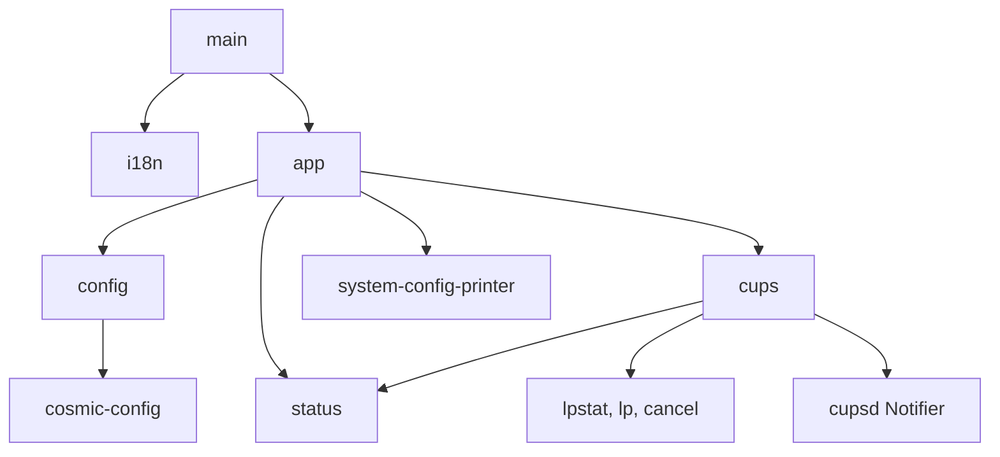
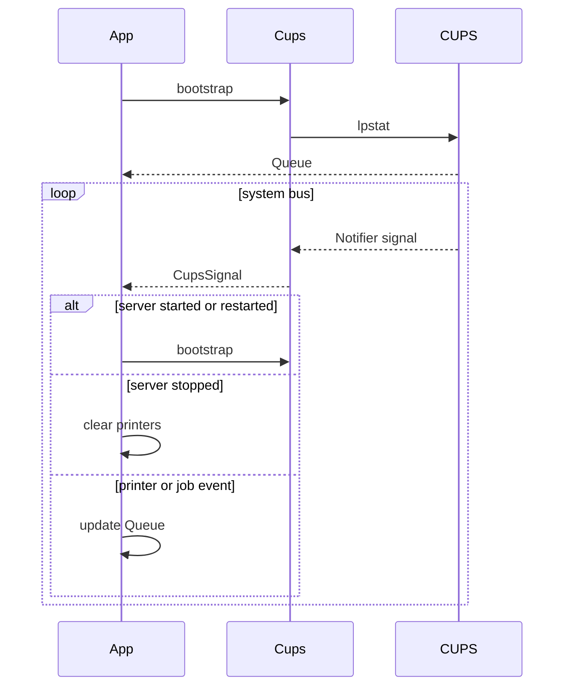

# Architecture

Printers is a panel applet for the COSMIC desktop. The binary is `cosmic-printers`. The app id is `io.github.drmaas.CosmicPrinters`.

The applet shows the CUPS (Common UNIX Printing System) queue and printer warnings. It can cancel a job or move a queued job ahead of other queued jobs. Printer setup and sharing stay in `system-config-printer`.

## Modules

`main` loads Fluent translations, then starts the libcosmic applet. `app` draws the panel button, the popup, and the confirm dialog. `cups` owns the queue, the `lpstat` parser, process actions, and the cupsd notifier. `status` is pure: it maps reasons to icons, tooltips, visibility, and the send-to-front index. `config` stores when the panel button is shown. `i18n` embeds the Fluent catalogs from `i18n/`.

English strings live in `i18n/en/cosmic_printers.ftl`. The `fl!` macro accepts only string literals. A new string needs a catalog line and a match arm in `app.rs`.

UI code calls the queue and the status helpers. Queue code calls status for display names and job-state constants.

## Startup

`AppModel::init` loads `Config` and starts with an empty queue. Two tasks run in parallel. One bootstraps the queue. The other detects optional tools.

Bootstrap runs on a blocking thread. Every `lpstat` call sets `LC_ALL=C` and `LANG=C`, so the parser sees English lines.

- `lpstat -e` lists destination names, including temporary DNS-SD discoveries. A missing `lpstat` sets `QueueError::NoClient`.
- `lpstat -l -p` defines which queues are installed. Those names are the bootstrap printer list. Temporary discoveries from `-e` are not shown when installed queues exist, so one physical device is not listed twice.
- `lpstat -v` supplies device URIs for bootstrap. When `-p` is empty, `-e` is used and destinations that share the same device identity (UUID or host) are collapsed.
- `lpstat -W not-completed -o` lists jobs that are not finished.

The destination list and the printer list can both fail. If nothing was parsed, the error is `QueueError::ListFailed`.

Job titles are empty after bootstrap. The popup shows them as unknown until a job signal supplies a name.

Tool detection looks for `system-config-printer` on `PATH`. It also asks the session bus whether `org.fedoraproject.Config.Printing` is owned or activatable.

## Live updates

Two subscriptions run until the applet exits.

cosmic-config emits `Message::UpdateConfig` when the saved `ShowIcon` changes. The CUPS subscription matches signals on the system bus. The interface is `org.cups.cupsd.Notifier`. The path is `/org/cups/cupsd/Notifier`. `cups::decode` turns known members into a `CupsSignal` and ignores the rest, including `ServerAudit`.

A dropped connection waits 5 seconds, then connects again.

`Queue::handle_signal` updates the in-memory queue.

- `ServerStarted` and `ServerRestarted` clear the queue and bootstrap again.
- `ServerStopped` clears the queue and waits.
- Printer signals insert, update, or delete one printer. When installed queues were loaded at bootstrap, temporary DNS-SD destinations stay hidden on live events too; `PrinterAdded` refreshes the installed queue list from `lpstat -p`.
- Job signals insert, update, or remove one job. Jobs that name a filtered destination are attached to the matching installed queue when device URIs share identity; otherwise no extra printer row is created. State `JOB_STATE_CANCELED` (7) or higher removes the job.

## Queue

`Queue` is an `IndexMap` of printers, plus an optional error. The map key is the CUPS printer name. Each `Printer` has an `IndexMap` of jobs keyed by job id. Map order is the order in the popup.

Display names replace `_` with a space. Command ids use `{printer}-{job id}`. The printer URI stays empty until a notifier signal sets it.

Warnings come from IPP (Internet Printing Protocol) `printer-state-reasons`. `status` maps known reasons such as `media-empty` and `toner-low`. The suffix `-error` marks an error. The suffixes `-warning` and `-report` mark warnings. Unknown reasons are ignored. A printer that is not accepting jobs gets a separate notice when no reason matches.

## Panel

`panel_status` chooses one icon and one tooltip for the whole queue.

A stopped printer sets the icon and the tooltip. The tooltip names the first stopped printer in queue order. Otherwise the icon follows the strongest remaining state: an error reason, then a warning, then jobs, then idle.

The button draws the count next to the icon when `job_count` is greater than zero. The count is the sum of jobs on every printer.

`ShowIcon` decides whether that button is drawn.

- `Always` draws the button with an empty queue.
- `Printers` draws it when at least one printer exists. This is the default.
- `Jobs` draws it only while at least one job exists.

If the button is hidden, the view is a zero-size spacer. The panel slot remains until the applet is removed.

The choice is saved with cosmic-config under the app id, config version 1.

## Popup

The popup is a Wayland window anchored to the panel button. Closing it drops any pending confirm.

Each printer row shows an icon, the display name, and a warning line when `row_notice` returns one. The name button runs `system-config-printer --show-jobs {name}` when that program exists. With no printer argument, the Printers button opens the same program for the full list. Both stay disabled when `system-config-printer` is not on `PATH`.

The properties button is shown only when `org.fedoraproject.Config.Printing` is available. It calls `PrinterPropertiesDialog` on the session bus, then closes the popup.

A processing job shows a running icon. Its title is the job name, cut at 30 characters, plus the creation time from `lpstat`.

Cancel asks for confirmation, then runs `cancel {printer}-{id}`. Cancel-all does that once per job on that printer. The in-memory job stays until a notifier signal removes it.

Send to front is for a queued job that is not already first. It stays hidden for the job directly behind a job that is printing. The action runs `lp -i {printer}-{id} -q 100`, then moves the job in the local `IndexMap`. A printing job stays at index 0, so the moved job goes to index 1. The next notifier signal overwrites that order.

## Tests

Unit tests parse sample `lpstat` text and apply `CupsSignal` values. They do not start CUPS. They do not open a bus connection.
